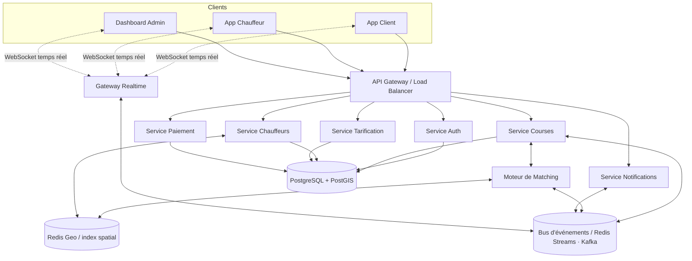
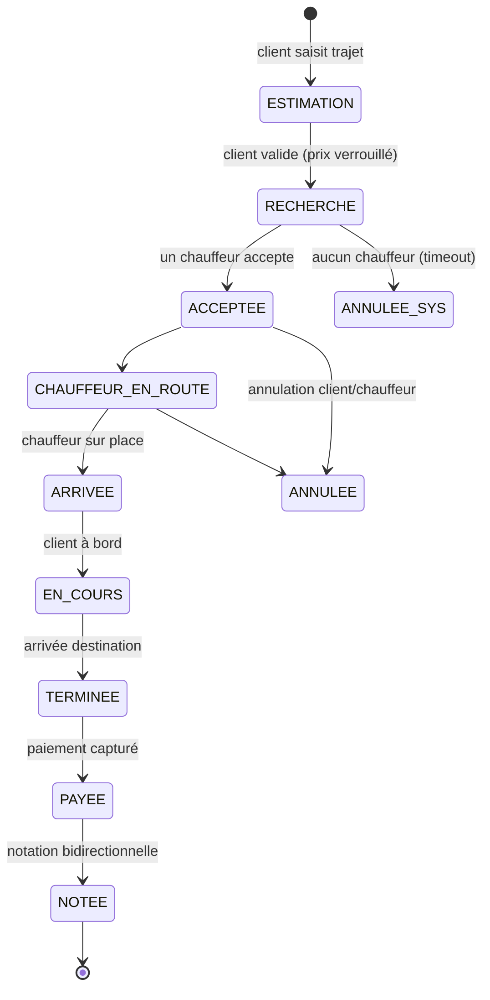

# ORION VTC — Vue d'ensemble de la plateforme

> Plateforme de mobilité verte (VTC) structurée autour de trois interfaces :
> **Application Client**, **Application Chauffeur** et **Tableau de bord Administrateur**.

## 1. Positionnement et principes différenciants

ORION se distingue par sept principes directeurs qui guident chaque décision produit et technique :

| Principe | Traduction concrète |
|----------|---------------------|
| **Interface simple et moderne** | Parcours en ≤ 3 écrans pour réserver, design system unifié, accessibilité AA |
| **Rapidité de réservation** | Estimation de prix < 500 ms, matching chauffeur < 5 s |
| **Sécurité passagers** | Partage de trajet, bouton SOS, vérification d'identité chauffeur, enregistrement du trajet |
| **Sécurité chauffeurs** | Validation documentaire, notation passagers, signalement, paiement garanti via wallet |
| **Transparence des prix** | Prix affiché et **verrouillé** avant validation, détail du calcul consultable |
| **Qualité de service** | Notation bidirectionnelle, seuils de qualité, programme de formation |
| **Extensibilité** | Architecture modulaire prête à accueillir livraison de colis, vélos/trottinettes, etc. |

## 2. Les trois interfaces

### 2.1 Application Client
- Création de compte (téléphone + OTP, e-mail, OAuth)
- Géolocalisation automatique
- Saisie point de départ / destination
- Estimation du prix **avant** validation (prix verrouillé)
- Choix de la catégorie de véhicule
- Suivi du chauffeur en temps réel
- Paiement : espèces, mobile money, carte bancaire
- Historique des courses
- Notation du chauffeur
- **Ajouts ORION** : partage de trajet, bouton SOS, contacts d'urgence, course programmée, favoris d'adresses, code promo, facturation

### 2.2 Application Chauffeur
- Inscription avec validation des documents
- Activation / désactivation de la disponibilité (statut en ligne / hors ligne)
- Réception des demandes de course (avec délai d'acceptation)
- Navigation GPS
- Suivi des revenus quotidiens
- Historique des courses
- Portefeuille (wallet) pour les paiements
- **Ajouts ORION** : objectifs de gains, zones à forte demande (heatmap), score d'acceptation/annulation, mode pause, retrait des gains (payout)

### 2.3 Tableau de bord Administrateur
- Validation des chauffeurs (workflow KYC)
- Gestion des véhicules
- Suivi en temps réel de toutes les courses (carte live)
- Statistiques (KPI métier et opérationnels)
- Gestion des commissions
- Gestion des promotions
- Support client
- **Ajouts ORION** : gestion des litiges, modération, tarification dynamique par zone, audit log, gestion des rôles (RBAC)

## 3. Architecture macro

Les détails de mise à l'échelle (stateless, sharding géographique, back-pressure)
sont décrits dans [`05-architecture-scalabilite.md`](./05-architecture-scalabilite.md).

## 4. Cycle de vie d'une course

## 5. Documents de référence

| Document | Contenu |
|----------|---------|
| [`02-user-flows.md`](./02-user-flows.md) | Parcours utilisateurs (client, chauffeur, admin) |
| [`03-criteres-validation-reglementaires.md`](./03-criteres-validation-reglementaires.md) | Documents requis et workflow de validation chauffeur |
| [`04-strategie-extension-services.md`](./04-strategie-extension-services.md) | Architecture d'extension multi-services |
| [`05-architecture-scalabilite.md`](./05-architecture-scalabilite.md) | Robustesse et passage à l'échelle |
| [`06-modele-de-donnees.md`](./06-modele-de-donnees.md) | Modèle de données et entités |
| [`11-console-sessions.md`](./11-console-sessions.md) | La console : accès, sessions, interconnexion, rôles |
