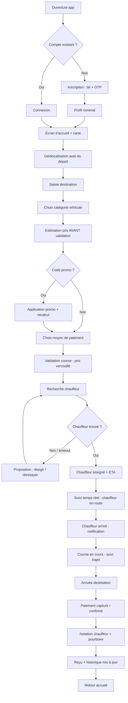
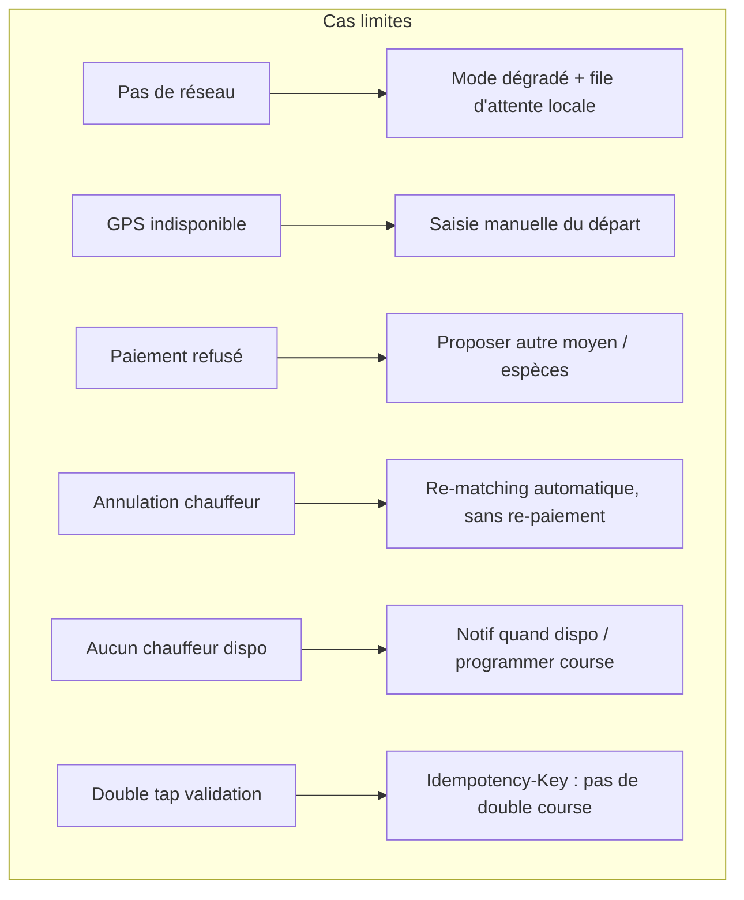
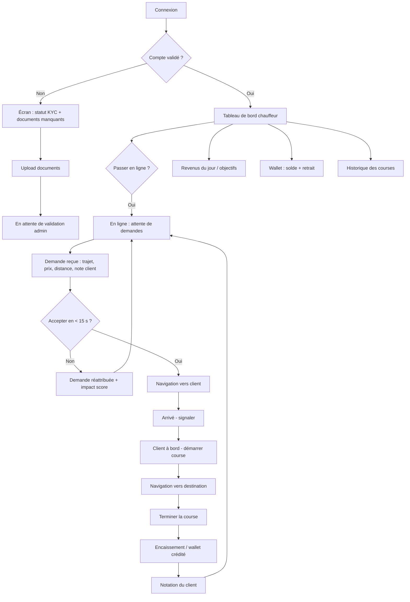
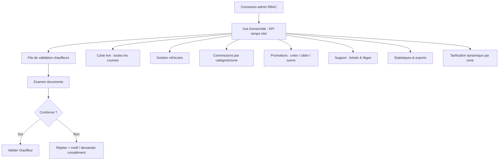

# ORION VTC — Parcours utilisateurs (User Flows)

Ce document modélise l'enchaînement des écrans pour les trois interfaces.
Les diagrammes utilisent la syntaxe Mermaid (rendue par GitHub).

---

## 1. Application Client — de l'ouverture à la notation

### 1.1 Flux nominal (vue d'ensemble)

### 1.2 Écrans détaillés

| # | Écran | Données affichées | Actions | Appel API |
|---|-------|-------------------|---------|-----------|
| 1 | Splash / Onboarding | Logo, valeur produit | Continuer | — |
| 2 | Inscription | Champ téléphone | Demander OTP | `POST /auth/otp/request` |
| 3 | Vérification OTP | 6 chiffres | Valider | `POST /auth/otp/verify` |
| 4 | Accueil | Carte, position, raccourcis (domicile/travail) | Saisir destination | `GET /me`, `GET /places/favorites` |
| 5 | Recherche destination | Autocomplétion adresses | Sélectionner | `GET /places/autocomplete` |
| 6 | Choix véhicule + estimation | Catégories, prix, ETA par catégorie | Sélectionner catégorie | `POST /pricing/estimate` |
| 7 | Confirmation | Prix **verrouillé**, paiement, promo | Confirmer | `POST /rides` |
| 8 | Recherche chauffeur | Animation, possibilité d'annuler | Annuler | WebSocket `ride.searching` |
| 9 | Suivi chauffeur | Position live, plaque, modèle, note, ETA, SOS | Appeler, partager, SOS | WebSocket `ride.driver_location` |
| 10 | En course | Itinéraire, ETA destination, partage | Partager trajet, SOS | WebSocket `ride.in_progress` |
| 11 | Fin / Paiement | Montant final, détail | Confirmer paiement | `POST /rides/:id/pay` |
| 12 | Notation | Étoiles, tags, pourboire, commentaire | Soumettre | `POST /rides/:id/rate` |

### 1.3 Flux d'erreur et cas limites

### 1.4 Compte, photo, paramètres et annulation

- **Compte** : nom, numéro, e-mail facultatif ; le numéro est vérifié par un code SMS à
  6 chiffres. Un numéro vérifié = un compte : sur un nouveau téléphone, le client retrouve
  son compte et son historique. Sur un téléphone partagé, une nouvelle inscription reçoit
  son propre compte et n'écrase jamais celui de la personne précédente.
- **Photo** : prise avec la caméra frontale ou choisie dans la galerie, recadrée et
  compressée par l'app, vérifiée octet par octet par le serveur. Visible par la console
  (fiche client) et dans le dossier SOS ; modifiable ou supprimable à tout moment.
- **Paramètres** : profil (photo, nom, e-mail, numéro vérifié, compteurs), historique des
  courses (terminées et annulées : qui, pourquoi, combien ; reçu, chauffeur, paiement,
  note, alerte SOS), alertes SOS, portefeuille, abonnement, sécurité, préférences, aide,
  conditions et confidentialité, déconnexion, suppression du compte.
- **Annulation** : motif obligatoire, frais annoncés avant de confirmer. Gratuite sans
  chauffeur attribué, pendant le délai de grâce, pour un motif de sécurité (le bouton SOS
  est proposé) ou si le chauffeur a demandé l'annulation (signalé à la console).
- Pendant la course, la carte « Course suivie par ORION · intervention possible » est en orange.

> **Règle de transparence** : entre l'écran 6 (estimation) et l'écran 11 (paiement),
> le prix ne change pas, **sauf** modification d'itinéraire par le passager
> (arrêt ajouté, destination changée) — auquel cas un nouvel écran d'estimation est présenté.

---

## 2. Application Chauffeur

### Statuts du chauffeur
`HORS_LIGNE` → `EN_LIGNE` → `EN_COURSE` → (`EN_PAUSE`) → `HORS_LIGNE`

---

## 3. Tableau de bord Administrateur

---

## 4. Légende des conventions

- **Prix verrouillé** : valeur figée par le backend (`pricing.lockId`) à l'estimation,
  ré-utilisée lors de la création de la course pour empêcher toute dérive.
- **Idempotency-Key** : en-tête HTTP fourni par le client sur les opérations sensibles
  (création de course, paiement) pour garantir l'absence de doublon malgré les ré-essais.
- **WebSocket** : canal temps réel pour la position du chauffeur et les transitions d'état.
