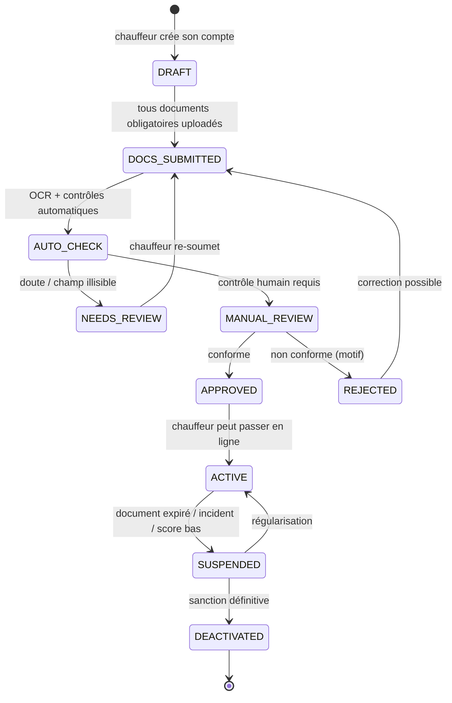

# ORION VTC — Critères de validation réglementaires (KYC chauffeur)

Ce document définit la liste précise des documents requis pour l'inscription d'un
chauffeur, le workflow de validation, et les règles de conformité continue.

> ⚠️ Les exigences exactes dépendent de la **juridiction d'exploitation**. Ce document
> fournit un socle complet, paramétrable par pays/zone via la table `compliance_rules`.
> À adapter avec un conseil juridique local avant mise en production.

---

## 1. Documents requis (chauffeur — personne physique)

| Code | Document | Obligatoire | Vérifications | Expiration suivie |
|------|----------|:-----------:|---------------|:-----------------:|
| `ID` | Pièce d'identité (CNI / passeport) | ✅ | Identité, photo, validité | ✅ |
| `DRIVING_LICENSE` | Permis de conduire (catégorie B + ancienneté min.) | ✅ | Catégorie, validité, ancienneté ≥ seuil | ✅ |
| `VTC_CARD` | Carte professionnelle VTC / autorisation transport de personnes | ✅ | Numéro, autorité émettrice, validité | ✅ |
| `CRIMINAL_RECORD` | Casier judiciaire (extrait récent) | ✅ | Absence de condamnations rédhibitoires, < 3 mois | ✅ (renouvellement périodique) |
| `MEDICAL_FITNESS` | Visite médicale d'aptitude (selon juridiction) | ⚠️ paramétrable | Aptitude valide | ✅ |
| `PROOF_OF_ADDRESS` | Justificatif de domicile | ✅ | < 3 mois | ❌ |
| `TAX_STATUS` | Statut fiscal / immatriculation (auto-entrepreneur, société…) | ✅ | N° d'enregistrement actif | ✅ |
| `BANK_DETAILS` | RIB / compte mobile money pour les payouts | ✅ | Titulaire = chauffeur | ❌ |
| `PROFILE_PHOTO` | Photo de profil conforme | ✅ | Visage visible, correspond à l'ID (liveness) | ❌ |

## 2. Documents requis (véhicule)

| Code | Document | Obligatoire | Vérifications | Expiration suivie |
|------|----------|:-----------:|---------------|:-----------------:|
| `VEHICLE_REGISTRATION` | Carte grise (certificat d'immatriculation) | ✅ | Titulaire/autorisation, correspondance plaque | ✅ |
| `INSURANCE_TRANSPORT` | Assurance **transport de personnes** (pas une assurance perso) | ✅ | Couverture passagers active, validité | ✅ |
| `TECHNICAL_INSPECTION` | Contrôle technique en cours de validité | ✅ | Date de validité, résultat favorable | ✅ |
| `GREEN_COMPLIANCE` | Conformité mobilité verte (vignette / motorisation éligible) | ✅ (ORION) | Électrique / hybride / faibles émissions | ✅ |
| `VEHICLE_PHOTOS` | Photos du véhicule (4 angles + plaque + intérieur) | ✅ | État, propreté, correspondance modèle | ❌ |
| `RIDESHARE_PERMIT` | Macaron / autorisation de stationnement le cas échéant | ⚠️ paramétrable | Selon zone | ✅ |

> **Spécificité ORION (mobilité verte)** : le document `GREEN_COMPLIANCE` impose un
> véhicule électrique, hybride, ou répondant au seuil d'émissions de la zone. Le critère
> exact (g CO₂/km, type de vignette) est défini par `compliance_rules.green_threshold`.

## 3. Workflow de validation



### Étapes détaillées
1. **DRAFT** — Compte créé, informations personnelles saisies.
2. **DOCS_SUBMITTED** — Tous les documents `obligatoire = ✅` sont fournis.
3. **AUTO_CHECK** — Contrôles automatisés :
   - OCR + extraction des champs (nom, dates, numéros)
   - Cohérence croisée (nom ID = nom permis = titulaire RIB)
   - Liveness / face match (photo profil vs ID)
   - Détection de falsification (qualité, métadonnées)
   - Vérification des dates d'expiration
4. **MANUAL_REVIEW** — Un agent admin valide les points non automatisables.
5. **APPROVED → ACTIVE** — Le chauffeur peut activer sa disponibilité.

## 4. Conformité continue (post-activation)

| Règle | Déclencheur | Action automatique |
|-------|-------------|--------------------|
| Expiration document | J-30, J-7, J-0 | Rappels, puis `SUSPENDED` à expiration |
| Casier périodique | Tous les N mois | Demande de renouvellement |
| Note moyenne < seuil | Calcul glissant | Alerte → formation → suspension |
| Taux d'annulation élevé | Fenêtre glissante | Avertissement → suspension temporaire |
| Incident / signalement SOS | Événement | Gel immédiat + enquête |
| Assurance/CT expiré | Date | Blocage du passage en ligne |

## 5. Critères rédhibitoires (rejet automatique)
- Document expiré au moment de la soumission (hors tolérance configurée)
- Incohérence d'identité entre documents
- Assurance ne couvrant pas le transport de personnes
- Permis de catégorie insuffisante ou suspendu
- Condamnation figurant dans la liste rédhibitoire de la juridiction
- Véhicule non conforme au critère mobilité verte
- Détection de falsification documentaire

## 6. Protection des données (RGPD / équivalent local)
- **Minimisation** : ne stocker que les champs extraits nécessaires, pas l'image brute au-delà du besoin.
- **Chiffrement** : documents chiffrés au repos (KMS), accès tracé (audit log).
- **Durée de conservation** : définie par `compliance_rules.retention_days` par type de document.
- **Droit à l'effacement** : purge sur demande, sauf obligation légale de conservation.
- **Cloisonnement** : seuls les rôles `compliance_officer` / `admin` accèdent aux pièces.

## 7. Modélisation (extrait)

```jsonc
// compliance_rules (par juridiction)
{
  "jurisdiction": "FR",
  "min_driver_age": 21,
  "min_license_years": 3,
  "green_threshold": { "type": "co2_g_km", "max": 50 },
  "required_driver_docs": ["ID","DRIVING_LICENSE","VTC_CARD","CRIMINAL_RECORD","PROOF_OF_ADDRESS","TAX_STATUS","BANK_DETAILS","PROFILE_PHOTO"],
  "required_vehicle_docs": ["VEHICLE_REGISTRATION","INSURANCE_TRANSPORT","TECHNICAL_INSPECTION","GREEN_COMPLIANCE","VEHICLE_PHOTOS"],
  "criminal_record_max_age_days": 90,
  "retention_days": { "default": 1825, "CRIMINAL_RECORD": 365 }
}
```

Voir l'implémentation type dans
[`../backend/src/modules/compliance`](../backend/src/modules/compliance).
