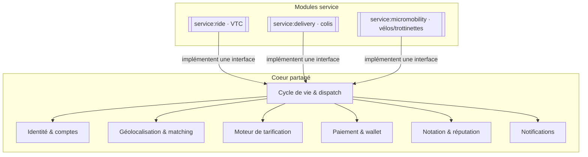
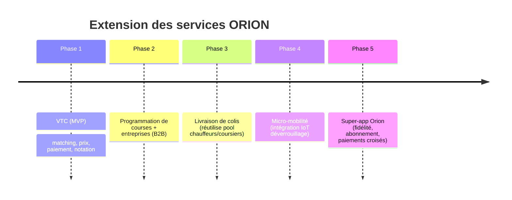

# ORION VTC — Stratégie d'extension multi-services

Objectif : anticiper l'architecture pour intégrer **facilement** de futurs services Orion
(livraison de colis, partage de vélos / trottinettes, etc.) sans réécrire le cœur.

---

## 1. Principe directeur : un « moteur de marketplace » générique

Le transport de personnes (VTC) n'est qu'**un cas particulier** d'un schéma plus large :

> Mettre en relation une **demande** (un client) avec une **offre** (un prestataire/actif),
> calculer un **prix**, gérer un **cycle de vie**, encaisser un **paiement**, et **noter**.

ORION est donc conçu comme un **moteur de mise en relation géolocalisée** où le VTC,
la livraison de colis et la micro-mobilité sont des **types de service** déclarés.



## 2. L'abstraction clé : `ServiceModule`

Chaque service implémente un **contrat commun**. Le cœur ne connaît que ce contrat.

```ts
interface ServiceModule {
  readonly type: ServiceType;            // 'ride' | 'delivery' | 'micromobility'
  readonly supplyKind: 'driver' | 'courier' | 'asset';

  estimate(req: EstimateRequest): Promise<Quote>;        // prix verrouillable
  findSupply(req: MatchRequest): Promise<SupplyMatch[]>; // matching géo
  lifecycle: StateMachine<JobState>;                     // états spécifiques
  fulfill(job: Job, event: JobEvent): Promise<Job>;      // transitions
}
```

| Service | `supplyKind` | Offre matchée | États spécifiques |
|---------|--------------|---------------|-------------------|
| **VTC** (`ride`) | `driver` | Chauffeur + véhicule | en route → arrivé → en course → terminé |
| **Livraison** (`delivery`) | `courier` | Coursier (peut être le même pool) | collecté → en transit → livré (preuve) |
| **Micro-mobilité** (`micromobility`) | `asset` | Vélo/trottinette (objet IoT, pas d'humain) | réservé → déverrouillé → en usage → verrouillé |

> La micro-mobilité illustre la puissance de l'abstraction : l'« offre » n'est plus
> une personne mais un **actif IoT**. Le matching devient « trouver l'asset disponible le
> plus proche », le « dispatch » devient « déverrouiller via commande IoT ».

## 3. Réutilisation du socle

| Brique | VTC | Livraison | Micro-mobilité |
|--------|:---:|:---------:|:--------------:|
| Comptes / Auth | ✅ | ✅ | ✅ |
| Géolocalisation & index spatial | ✅ | ✅ | ✅ |
| Tarification (stratégies pluggables) | distance+temps | poids+distance | déblocage+durée |
| Paiement & wallet | ✅ | ✅ | ✅ |
| Notation & réputation | ✅ | ✅ | ✅ (état du matériel) |
| Notifications temps réel | ✅ | ✅ | ✅ |
| KYC / conformité | chauffeur | coursier | maintenance actif |

Seuls changent : la **stratégie de prix**, la **nature de l'offre**, et la **machine à états**.

## 4. Décisions d'architecture qui rendent l'extension « facile »

1. **Modularité par domaine** — `src/modules/<service>` isolé ; le cœur expose des ports/interfaces.
2. **Tarification par stratégie** — `PricingStrategy` injectable (pattern Strategy), pas de `if service == ...`.
3. **Machine à états déclarative** — états/transitions en data, pas en code en dur.
4. **Bus d'événements** — les services publient des événements (`job.completed`, `payment.captured`)
   consommés par les briques transverses (notation, stats, fidélité), couplage faible.
5. **Catalogue de services activable par zone** — `service_catalog` : un service peut être
   lancé ville par ville sans redéploiement.
6. **API versionnée & multi-service** — endpoints `/services/:type/...` homogènes.
7. **Schéma de données polymorphe** — table `jobs` générique + tables de détail par service.

## 5. Feuille de route d'extension (exemple)



## 6. Ce qu'il faut éviter (anti-patterns)
- ❌ Coder le VTC en dur dans le cœur puis « bricoler » la livraison par-dessus.
- ❌ Dupliquer auth/paiement/notation par service.
- ❌ Conditionner la logique métier par des `switch (serviceType)` éparpillés.
- ❌ Coupler le temps réel à un seul format de message propre au VTC.

## 7. Implémentation de référence
Le backend de ce dépôt pose déjà la fondation : un registre de services
(`src/modules/services/registry.ts`) et une interface `ServiceModule`, avec le VTC
comme première implémentation. Ajouter la livraison = créer un nouveau module qui
implémente l'interface et l'enregistrer — **sans toucher au cœur**.
