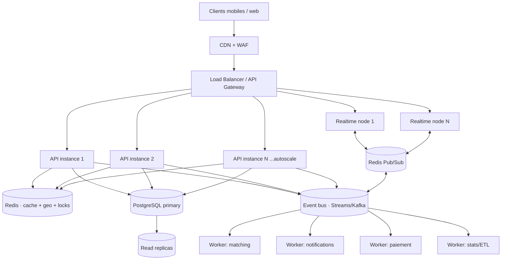
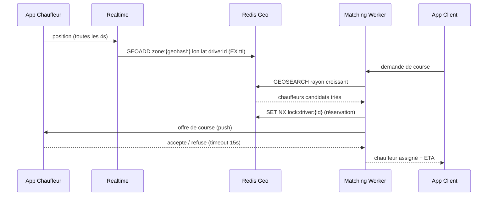

# ORION VTC — Architecture, scalabilité et robustesse

> Objectif : « le système ne bug pas, peu importe le nombre d'utilisateurs connectés ».
> Aucun système n'est infaillible, mais on s'en approche avec des principes éprouvés :
> **stateless, horizontal, asynchrone, observable, et tolérant aux pannes.**

---

## 1. Principes fondateurs

| Principe | Pourquoi | Comment dans ORION |
|----------|----------|--------------------|
| **Services stateless** | Permet d'ajouter des instances à l'infini derrière un load balancer | Aucune session en mémoire ; état dans PostgreSQL/Redis |
| **Scalabilité horizontale** | Monter en charge = ajouter des machines, pas une plus grosse | Conteneurs sans état, autoscaling sur CPU/latence/file |
| **Asynchrone & event-driven** | Découpler les pics ; ne pas bloquer | Bus d'événements (Redis Streams / Kafka), workers |
| **Idempotence** | Les ré-essais ne créent pas de doublons | `Idempotency-Key` sur créations/paiements |
| **Back-pressure & limites** | Un pic ne doit pas faire tomber le système | Rate limiting, files bornées, rejets gracieux (429) |
| **Dégradation gracieuse** | Une panne partielle ≠ panne totale | Circuit breakers, timeouts, fallbacks |
| **Observabilité** | On ne corrige que ce qu'on mesure | Logs structurés, métriques, traces, alertes |

## 2. Vue de déploiement scalable

## 3. Le point chaud : le matching géolocalisé en temps réel

C'est la partie la plus sollicitée (chaque chauffeur émet sa position toutes les ~4 s).

### Stratégies
1. **Index géospatial en mémoire** — Redis `GEOADD`/`GEOSEARCH` (ou PostGIS) pour
   « trouver les chauffeurs dans un rayon » en O(log n).
2. **Sharding géographique** — partitionner par zone (geohash / cellules H3). Une ville =
   un shard ; ajouter des villes n'impacte pas les autres.
3. **Écriture des positions découplée** — les positions arrivent sur un canal léger,
   bufférisées, puis écrites par lots (pas une transaction SQL par ping).
4. **Verrou d'assignation** — `SET NX` (Redis lock) pour qu'un chauffeur ne soit proposé
   qu'à une course à la fois (évite la double assignation en concurrence).
5. **TTL de présence** — la position expire (TTL) : un chauffeur déconnecté disparaît
   automatiquement de l'index, pas de « fantômes ».

## 4. Temps réel à grande échelle (WebSocket)
- Nœuds realtime **stateless**, scalés horizontalement.
- Fan-out via **Redis Pub/Sub** : un client connecté au nœud A reçoit les events publiés
  depuis le nœud B.
- **Heartbeat / reconnexion** automatique côté client ; reprise d'état à la reconnexion.
- **Rooms** par course (`ride:{id}`) pour limiter le trafic au strict nécessaire.

## 5. Données : tenir la charge
- **PostgreSQL** primaire pour les écritures transactionnelles (courses, paiements).
- **Read replicas** pour les lectures lourdes (historique, dashboard).
- **Partitionnement** des tables volumineuses (`rides`, `driver_locations`) par date/zone.
- **Cache Redis** pour les lectures chaudes (profils, tarifs de zone, catalogue services).
- **Idempotence** stockée pour neutraliser les ré-essais réseau.
- **Outbox pattern** : les événements métier sont écrits dans la même transaction que la
  donnée, puis publiés sur le bus — garantit « pas de course payée sans event paiement ».

## 6. Robustesse / tolérance aux pannes
- **Timeouts partout** (HTTP, DB, externes) — jamais d'attente infinie.
- **Retries avec backoff exponentiel + jitter** sur opérations idempotentes.
- **Circuit breaker** sur les dépendances externes (paiement, cartes, SMS) → fallback.
- **Bulkheads** : isoler les pools de ressources par dépendance (une panne SMS ≠ panne DB).
- **Graceful shutdown** : drain des requêtes en cours avant l'arrêt d'une instance.
- **Health checks** : `/health/live` (process) et `/health/ready` (dépendances) pour
  l'orchestrateur (Kubernetes) — une instance non prête ne reçoit pas de trafic.
- **DLQ** (dead-letter queue) : les messages non traités après N essais sont isolés, pas perdus.

## 7. Protection contre la surcharge
- **Rate limiting** par utilisateur / IP / endpoint (token bucket dans Redis).
- **Quotas** sur les opérations coûteuses (estimations, autocomplétion).
- **Files bornées** + rejet `429`/`503` avec `Retry-After` plutôt qu'effondrement.
- **Load shedding** : sous forte charge, prioriser les opérations critiques (course en cours)
  vs non critiques (stats).

## 8. Observabilité
- **Logs structurés** (JSON) avec `requestId` / `correlationId` propagé.
- **Métriques** (Prometheus) : latence p50/p95/p99, taux d'erreur, profondeur des files,
  temps de matching, taux d'acceptation.
- **Traces distribuées** (OpenTelemetry) à travers API → bus → workers.
- **Alerting** sur SLO (ex. p99 matching < 5 s, dispo API ≥ 99.9 %).

## 9. Sécurité (transverse)
- TLS partout, secrets en coffre (KMS/Vault), JWT courts + refresh, RBAC admin.
- Validation stricte des entrées (schema), protection injection, WAF.
- Chiffrement au repos des données sensibles (documents KYC, RIB).
- Audit log immuable des actions admin.

## 10. Stratégie de tests pour la fiabilité
- Tests unitaires (tarification, machines à états, idempotence).
- Tests d'intégration (API + DB + Redis via conteneurs).
- **Tests de charge** (k6 / Gatling) simulant N milliers de chauffeurs/clients.
- **Chaos testing** : couper Redis/DB/dépendances pour valider la dégradation gracieuse.

## 11. Ce que pose déjà ce dépôt
Le backend de référence implémente concrètement : services **stateless**, **idempotence**,
**rate limiting**, **health checks** `live`/`ready`, **graceful shutdown**, **logs
structurés**, index géo **abstrait** (Redis-ready avec fallback mémoire pour tourner sans
infra), et **back-pressure**. Voir [`../backend`](../backend).
