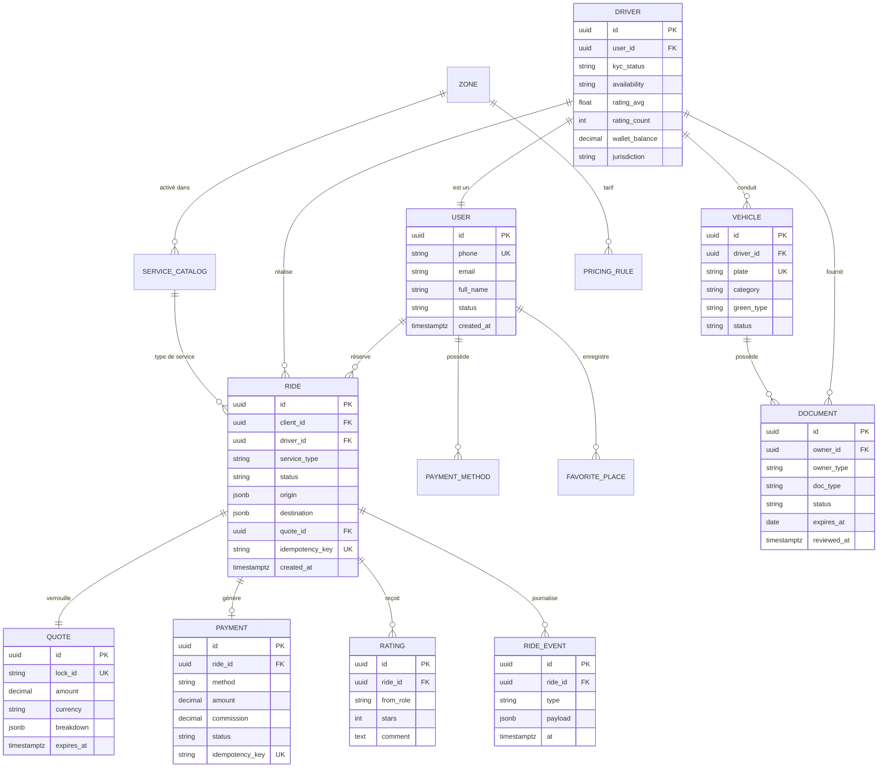

# ORION VTC — Modèle de données

Modèle conçu pour le multi-service (voir [`04-strategie-extension-services.md`](./04-strategie-extension-services.md))
et le passage à l'échelle (voir [`05-architecture-scalabilite.md`](./05-architecture-scalabilite.md)).

## Tables transverses
- `compliance_rules` — règles KYC par juridiction (cf. doc 03).
- `pricing_rules` — paramètres de tarification par zone & catégorie & service.
- `service_catalog` — services activés par zone (cf. doc 04).
- `idempotency_keys` — neutralise les doublons de requêtes.
- `audit_log` — trace immuable des actions admin.
- `driver_locations` — positions (volatile : Redis Geo en prod ; table partitionnée pour l'historique).

## Choix structurants
- **`service_type` sur `RIDE`** + table générique `jobs` à terme : socle multi-service.
- **`idempotency_key` unique** sur `RIDE` et `PAYMENT` : robustesse aux ré-essais.
- **`QUOTE.lock_id`** : prix verrouillé entre estimation et création (transparence).
- **`RIDE_EVENT`** : journal d'événements = source de vérité pour le temps réel et l'audit.
- **`jsonb`** pour `origin`/`destination`/`breakdown` : flexibilité sans migration lourde.
