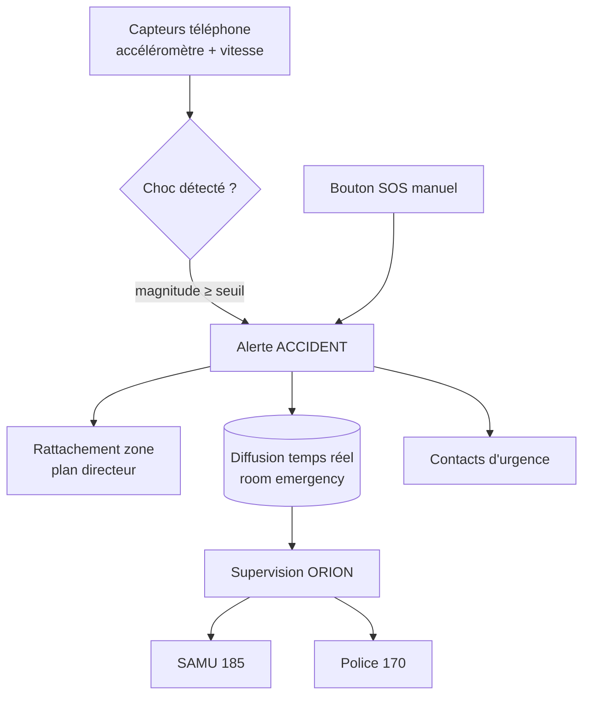

# ORION VTC — Côte d'Ivoire, sécurité & temps réel

Ce document décrit les capacités ajoutées pour l'exploitation en **Côte d'Ivoire** :
localisation (plan directeur), paiements locaux, détection d'accident + secours SAMU,
tracking temps réel, et partenariat Google Maps.

---

## 1. Localisation — plan directeur de la Côte d'Ivoire

Module : [`../backend/src/modules/geo-ci/zones.ts`](../backend/src/modules/geo-ci/zones.ts)

- **Grand Abidjan** : communes de Plateau, Cocody, Yopougon, Abobo, Adjamé, Treichville,
  Marcory, Koumassi, Port-Bouët, Attécoubé, Bingerville, Songon, Anyama + Grand-Bassam,
  et pôles à forte demande (Aéroport FHB, gare d'Adjamé).
- **Échelle nationale** : Yamoussoukro, Bouaké, San-Pédro, Korhogo, Daloa, Man, Gagnoa,
  Abengourou, Divo, Soubré, Bondoukou, Odienné.
- Chaque zone porte un **centroïde**, un **rayon** et un **coefficient de demande**
  (surge). Le surge combine le coefficient de zone et les **heures de pointe d'Abidjan**
  (06h30–09h, 17h–20h), borné à ×2 pour la transparence.
- **Validation de la zone de service** : un trajet hors des bornes ivoiriennes est refusé.

Endpoints : `GET /geo/zones`, `POST /geo/resolve`.

## 2. Paiements — marché ivoirien

Module : [`../backend/src/modules/payments`](../backend/src/modules/payments)

- **Mobile money en priorité** : Orange Money, MTN MoMo, Moov Money, Wave + espèces + carte.
- Devise **XOF (FCFA)**, montants arrondis au multiple de 50.
- Chaque opérateur est un **adaptateur** derrière une interface commune → on branche les
  API réelles (ou un agrégateur type CinetPay/PayDunya) sans toucher au reste.
- Paiement **idempotent** (`Idempotency-Key`).

Endpoints : `GET /payments/methods`, `POST /rides/:id/pay`.

## 3. Sécurité — détection d'accident & secours SAMU

Module : [`../backend/src/modules/safety`](../backend/src/modules/safety)

- **Détection automatique** : on calcule la magnitude d'impact (en g, gravité retirée).
  Un accident probable = choc très violent, **ou** choc fort + véhicule en mouvement
  (réduit les faux positifs comme un téléphone qui tombe à l'arrêt).
- **SOS manuel** en 1 tap depuis l'app.
- Sur déclenchement : alerte **dispatchée** au **SAMU (185)** et à la police (170),
  localisée et rattachée à une zone, diffusée en **temps réel** au poste de supervision.
- Numéros d'urgence CI : SAMU **185**, Police **170**, Pompiers **180**, Police-secours **111**.

Endpoints : `POST /safety/sos`, `POST /safety/sensor`, `GET /safety/alerts`,
`POST /safety/alerts/:id/status`, `GET /safety/emergency-numbers`.

## 4. Tracking temps réel (WebSocket)

Module : [`../backend/src/modules/realtime`](../backend/src/modules/realtime)

- `GET /ws/rides/:id` : flux d'une course (position chauffeur, transitions d'état, alertes).
- `GET /ws/emergency` : flux du poste de supervision (alertes SOS / accidents → SAMU).
- Hub pub/sub par **room**, heartbeat ping/pong, nettoyage à la déconnexion.
- Multi-instances : le hub s'adosse à **Redis Pub/Sub** (cf. [05](./05-architecture-scalabilite.md) §4).

## 5. Partenariat Google Maps

Module : [`../backend/src/modules/maps`](../backend/src/modules/maps)

- Couche **abstraite** `MapsProvider` : avec une clé `GOOGLE_MAPS_API_KEY`, on utilise
  **Google Directions / Places** (itinéraires réels, trafic, restreints à la CI) ; sans
  clé, on bascule sur un calcul interne — **l'app reste fonctionnelle**.
- Endpoints : `POST /maps/route`, `GET /maps/autocomplete`.

## 6. Périmètre applicatif

> L'**application client** est livrée en premier (dossier [`../frontend`](../frontend)).
> L'**application chauffeur** est un projet **séparé**, prévu pour la suite, et réutilisera
> le même backend (matching, KYC chauffeur, wallet, navigation).
